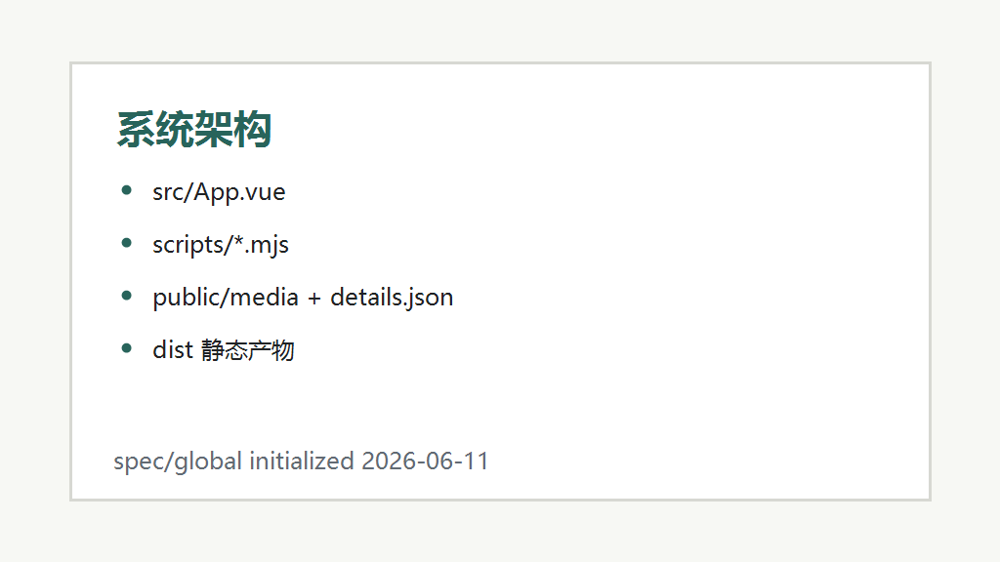
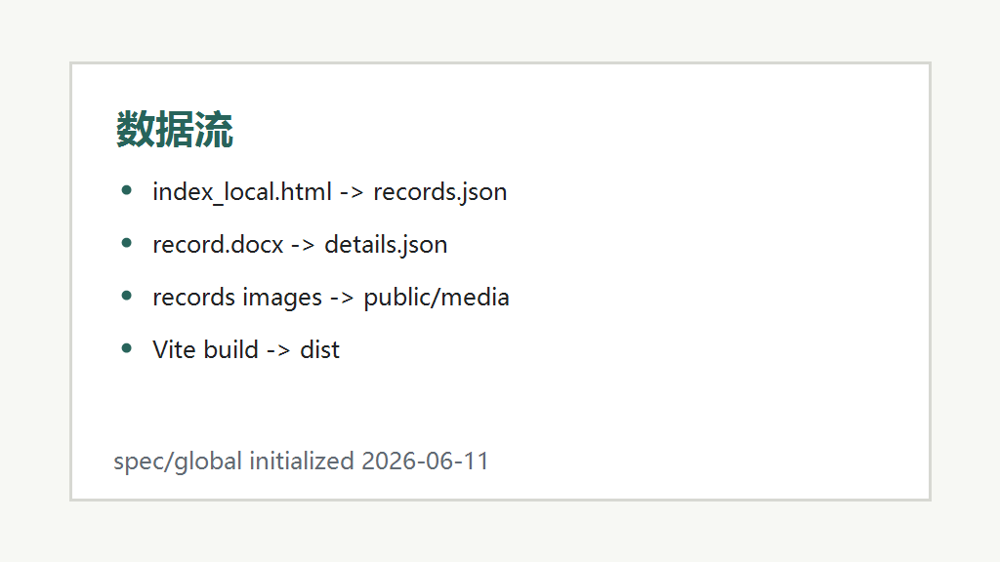

# 架构全景

## 系统组件

- **Vue 3 单页应用:** `src/App.vue` 保留应用 shell，页面由 Vue Router 分发，跨页面运行态由 Pinia store 管理。
- **Element Plus:** 提供按钮、输入框、选择器、表格、轮播、空态和 tooltip 等 UI 组件。
- **数据生成脚本:** `scripts/extract-library-data.mjs` 从 `index_local.html` 同步馆藏 JSON；`scripts/extract-docx-details.mjs` 从每条 `record.md` 生成详情 HTML；`scripts/prepare-public.mjs` 复制 records 静态资源；`scripts/validate-body-parts.mjs` 校验配件阁静态尺寸资料。
- **静态资源目录:** `public/media/` 保存可部署图片与档案副本，`public/details/{detailKey}.html` 保存详情页正文 HTML。
- **部署流水线:** GitHub Actions 在 main 推送后校验、构建、回归生产产物并上传 `dist/` 到 Pages。

## 模块划分

- **应用入口:** `src/main.js` 初始化 Vue、Pinia、Vue Router、Element Plus 与全局图标。
- **路由层:** `src/router/index.js` 使用 `createWebHashHistory(import.meta.env.BASE_URL)`，固定提供 `overview`、`library`、`index`、`repository`、`body-builder` 等静态站点路由。
- **状态层:** `src/stores/preferences.js` 管理语言、document lang 与主题；`src/stores/library.js` 管理筛选、详情和记录派生数据；`src/utils/catalogData.js` 合并并发按需读取，首页独立使用 `librarySummary.json`。
- **交互计算层:** `src/composables/useRecordRoute.js` 管理馆藏与限定详情地址及返回位置；`useBodySelection.js` 管理组合选择与尺寸；`usePartPreview.js` 管理配件预览、筛选及档案关联。
- **页面层:** `src/pages/` 保存页面组件，`src/components/` 保存侧边栏、筛选、卡片、详情、轮播和 `body-builder/` 配件阁组件。
- **样式系统:** `src/styles/index.css` 汇总 `tokens/base/layout/pages/detail/body-builder/footer/drawer/responsive` 分层样式，保持选择器顺序以降低视觉回归风险。
- **数据源:** 三份完整馆藏索引按相关页面异步打包，首页只打包摘要；`bodyParts.json`、`headParts.json` 是配件阁静态尺寸资料；`partSources.json` 仅供校验，不进入网页展示；`public/details/{detailKey}.html` 为按需 fetch 的详情。外站列表封面映射由 `catalogCovers.json` 指向正式缓存 `public/catalog-covers/`。
- **计算工具:** `src/utils/bodyCode.js` 负责组合码解析、默认选择和复制摘要；`src/utils/measurements.js` 负责尺寸汇总和缺失项识别，不读取来源说明。
- **原始档案:** `records/` 保存原始图片、`record.docx` 和部分 `record.md`。

## 数据流

1. `index_local.html` 内嵌 JSON 经 `extract-library-data.mjs` 生成 `src/data/records.json`。
2. `records/{folder}/record.md` 经 `extract-docx-details.mjs` 生成 `public/details/{detailKey}.html`。
3. `records/{folder}/images` 经 `prepare-public.mjs` 复制到 `public/media/{safeFolder}/`。
4. `summarize-library.mjs` 生成首页统计与最近发行条目的小摘要；Vite 将完整索引拆成异步 chunk，并把 `public/` 复制到 `dist/`。
5. 进入馆藏、限定或总索引后加载完整数据。用户打开条目更新 `query.record`，详情 HTML 经 `sanitizeHtml()` 白名单处理后渲染；直接打开链接、刷新或历史导航可恢复。
6. 用户进入配件阁后，页面读取打包内的 `bodyParts.json` 和 `headParts.json`，在浏览器内完成组合码和尺寸计算；来源说明只维护在 `spec/feature_20260618_F001_mjd-body-builder/part-sources.md`。

## 外部集成

- **GitHub Actions:** Node 20 + npm cache + `npm run build`。
- **GitHub Pages:** 静态托管，`BASE_PATH=/angelphilia-library/` 用于资源前缀。

## 部署拓扑

本项目无后端服务、数据库或容器运行时。部署产物为 `dist/` 静态文件，包含 HTML、JS、CSS、`media/` 和 `details/` 等公共资源。

---
*最后更新: 2026-11-17 — 按需馆藏、详情地址、配件 composable 与生产验收流程*
