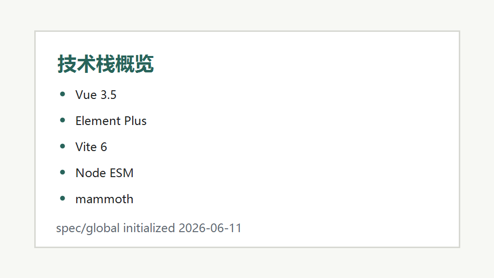

# 项目架构约束

## 技术栈

- **语言:** JavaScript ESM、Vue SFC、CSS。
- **前端框架:** Vue 3.5。
- **路由:** Vue Router 4，使用 hash history 兼容 GitHub Pages。
- **状态管理:** Pinia，仅管理浏览器运行态。
- **UI 库:** Element Plus 2.8。
- **后端框架:** （未检测到）。
- **数据库:** （未检测到）。
- **缓存:** （未检测到）。
- **构建工具:** Vite 6。
- **包管理器:** npm，使用 `package-lock.json` 固定依赖。
- **文档转换:** `scripts/extract-docx-details.mjs` 读取 `record.md` 并生成 `public/details/{detailKey}.html`，当前不再依赖 `mammoth` 解析 `.docx`。

## 架构决策

- **目录结构:** `src/` 放运行时应用，`scripts/` 放构建前数据准备脚本，`records/` 放原始档案，`public/` 放 Vite 会复制的静态资源。
- **分层架构:** 静态站点，无后端 API；数据准备在 Node 脚本阶段完成，浏览器运行时只读取打包 JSON 和 public JSON。
- **状态管理:** `usePreferencesStore` 管理语言/主题并同步 document lang；`useLibraryStore` 管理馆藏筛选和详情缓存，完整馆藏按相关路由加载，首页与侧栏使用构建时生成的 `librarySummary.json`。
- **通信模式:** 浏览器按需加载静态 JSON 模块，并通过 `fetch(details/{detailKey}.html)` 读取本地详情。

## API 风格

- **风格:** 无后端 API；运行时读取静态 JSON。
- **认证方式:** 无认证。
- **错误处理:** 卡片保留加载状态、一次自动重试及手动重试；本站缓存封面优先、原图备用。详情 HTML 必须在 dev/build 中生成；异步页面加载失败提供三语重试入口。

## 编码规范

- **编码:** 所有文件读写显式使用 UTF-8，避免 Windows PowerShell 默认编码导致中文/日文乱码。
- **命名约定:** `records.json` 中条目使用 `safeFolder` 和 `detailKey` 关联 `public/media/` 与 `public/details/{detailKey}.html`。
- **文件组织:** 新增数据生成能力优先放入 `scripts/`，不要把 docx 转换逻辑放到浏览器运行时。
- **资源路径:** 本站图片包括 `media/{safeFolder}/...`、`catalog-covers/`、`outfits/` 和 `images/`，统一通过 `assetUrl()` 结合 `import.meta.env.BASE_URL` 生成部署路径；详情画廊允许保留原外站图片。
- **列表与详情:** 馆藏和外装首批 24 条，追加展示不影响全量筛选。馆藏与限定详情以 `query.record` 保存稳定标识，支持刷新和历史导航；返回列表保留当前筛选与滚动。外装详情保留完整日文原文，不用摘要替代全文。
- **长图集滚动与加载:** 桌面 `.main-panel` 默认隐藏溢出，新增长图集路由时须将该路由加入独立滚动样式。官妆实拍用固定比例占位和 `IntersectionObserver` 按可见区域请求 WebP 缩略图，点开预览后才请求原图。验证时在冷缓存下比较首屏请求，再用桌面滚轮和窄屏滚动确认最后一张缩略图能加载。
- **配件阁数据:** `bodyParts.json`、`headParts.json` 和 `partSources.json` 必须保持静态可打包，所有非空尺寸值必须为 number、单位必须为 `cm` 且必须有泛化 `sourceId`。
- **来源脱敏:** 配件阁网页 UI 和复制内容不得展示具体来源 URL、平台、作者、截图说明或“来源说明”面板；具体数据来源只允许单独记录在维护用 Markdown（当前为 `spec/feature_20260618_F001_mjd-body-builder/part-sources.md`）。`bodyParts.json`、`headParts.json` 仅保留泛化 `sourceId` 供校验；`Obitsu` 仅可作为配件体系名称或默认件名称出现。
- **更新日志 UI:** 侧栏只保留低干扰入口；点击后必须在站内弹窗查看。弹窗默认只展示最近 3 条；“完整更新记录”只能在同一弹窗内切换全量列表，并使用弹窗内部滚动，不得跳转或外链到 Markdown 文件作为主要查看路径。

## 部署方式

- **环境:** GitHub Pages 静态部署。
- **CI/CD:** `.github/workflows/pages.yml` 在 `main` 推送和手动触发时执行依赖审计、资料校验、单元测试、构建和 Pages 子路径生产预览回归，再上传 `dist/`。
- **数据一致性:** dev/build 在馆藏同步后执行 `sync:summary`；`node scripts/summarize-library.mjs --check` 和封面缓存 `--check` 必须通过。封面下载只通过显式维护命令执行，不加入外网构建依赖。
- **构建前置:** `build` 必须同步馆藏数据、详情 HTML 和 public 静态资源，确保 `dist/details/` 与 `dist/media/` 覆盖所有条目。

## 安全约束

- **内容来源:** 页面展示本地维护的档案内容和外部来源链接；外链使用 `target="_blank"` 时必须保留 `rel="noopener noreferrer"`。
- **HTML 渲染:** 仅档案详情使用受控 `v-html` 入口，渲染前必须通过 `sanitizeHtml()` 白名单过滤；必须先清理后代再展开未知标签，删除执行性内容，链接与图片采用协议白名单。仓库说明等普通链接不得通过 HTML 字符串渲染。
- **静态构建:** 不在仓库提交 `dist/`、`public/media/`、`public/records/` 等生成产物。
- **配件阁校验:** 发布前运行 `npm run validate:body-parts`，阻断具体来源文本、缺失 `sourceId`、非 `cm` 单位和 P 型 eye size 误补。

---
*最后更新: 2026-11-17 — 首页摘要、按需加载、封面恢复、稳定详情地址与生产回归约定*
